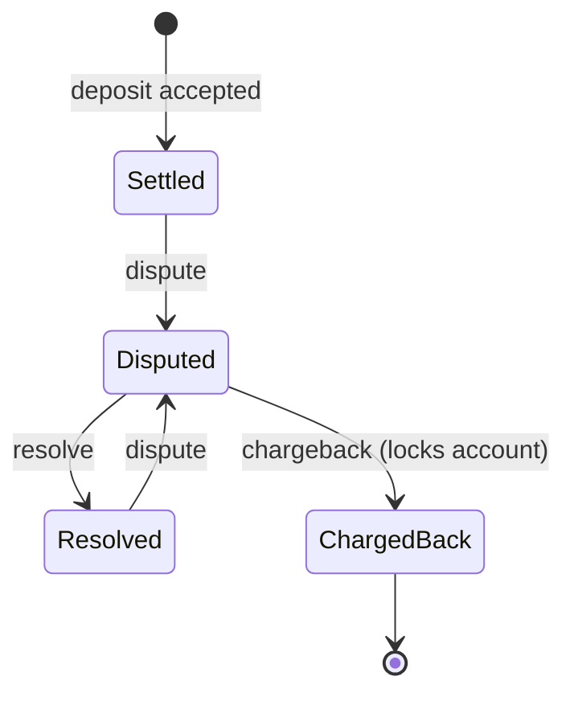

# Product

## What it does

`payments-engine` replays a batch of client transactions and reports where every client
account ends up. It reads a CSV file of deposits, withdrawals and dispute events in the
order they happened, applies them to one account per client, and prints each account's
available, held and total funds and whether it is locked.

```console
$ cargo run -- transactions.csv > accounts.csv
```

The engine behaves like a conservative bank back office: it never invents or rounds
money, it refuses anything it cannot apply exactly, and it records why.

## Ledger rules

Each client has one account with three balances and a lock flag. `total` is always
`available + held`.

| Row          | Effect when accepted                                     | Refused when                                                  |
|--------------|----------------------------------------------------------|---------------------------------------------------------------|
| `deposit`    | `available` and `total` go up by the amount               | ID already used, account locked, balance would overflow       |
| `withdrawal` | `available` and `total` go down by the amount             | ID already used, account locked, not enough `available` funds |
| `dispute`    | The deposit's amount moves from `available` to `held`     | See dispute rules below                                       |
| `resolve`    | The deposit's amount moves from `held` back to `available` | See dispute rules below                                       |
| `chargeback` | `held` and `total` go down by the amount; account locks   | See dispute rules below                                       |

Dispute, resolve and chargeback rows refer to an earlier transaction by its ID and carry
no amount of their own. Checks run in this order, and the first failure decides the
reason code:

1. The ID exists (`unknown_tx`).
2. It belongs to the client named on the row (`client_mismatch`).
3. It is an accepted deposit (`not_disputable`).
4. Its dispute state allows the step (`already_disputed`, `not_under_dispute`,
   `charged_back`).
5. The new balances fit (`balance_overflow`).

A deposit moves through these states:



## Decisions

Each decision fills a gap in the requirements. The reasoning is what a bank or card
processor would do.

### Money and precision

- **Fixed-point, four decimal places.** Amounts are stored as whole multiples of 0.0001
  in a 64-bit integer, about ±922 trillion. Floating point is never used, so values are
  exact.
- **More than four decimals are rejected unless the extra digits are zeros.**
  `1.50000` is exactly 1.5 and is accepted; `1.23456` would need rounding, and a bank
  does not round money it was told to move (`amount_too_precise`).
- **Amounts must be greater than zero.** A zero deposit moves nothing. Accepting one
  would let someone dispute and charge back a 0.00 deposit and lock an account for
  nothing (`amount_not_positive`).
- **Only plain decimals.** Accepted forms are `1`, `1.`, `.5` and `0012.3400`. Signs,
  exponents, thousands separators and `NaN` are rejected (`invalid_amount`).
- **Overflow is refused, not wrapped.** A transaction that would push any balance out of
  range is rejected (`balance_overflow`) and nothing changes.
- **Output always has four decimals** (`1.5000`), so every value has the same precision.

### Disputes

- **Only accepted deposits can be disputed.** A dispute reverses money that came in,
  like a card or bank-transfer chargeback. Disputing a withdrawal would hold money the
  client never had back, and a declined deposit never moved any money
  (`not_disputable`).
- **A dispute may push `available` below zero.** If a client deposits 100, withdraws 80
  and the deposit is then disputed, the full 100 is held and `available` becomes −80.
  Refusing the dispute would let exactly this fraud pattern succeed. After a chargeback,
  the negative total is what the client owes.
- **The row's client must own the transaction.** A dispute naming a different client is
  treated as a partner error and ignored (`client_mismatch`). One client can never move
  another client's funds, and ownership is checked before the transaction's type or
  dispute state is revealed.
- **A resolved deposit can be disputed again; only a chargeback is final.** Card disputes
  can be reopened after the merchant wins, while a chargeback ends the process.
- **An amount on a dispute, resolve or chargeback row is ignored.** The referenced deposit
  is the source of truth.

### Locked accounts

- **A chargeback locks the account.** After that, deposits and withdrawals are refused
  (`account_locked`).
- **Disputes on earlier deposits still apply to a locked account.** A frozen account
  stops client-initiated movements but remains subject to external claims, so a later
  chargeback is still recorded instead of hidden.

### Transaction IDs and accounts

- **Transaction IDs are unique across the whole input.** A deposit or withdrawal reusing
  an ID is refused (`duplicate_tx`), even if the first use was itself declined. A replayed
  row therefore never applies twice.
- **When an account is created.** A deposit or withdrawal that passes validation and has
  a fresh ID creates the account, even if it is then declined. A client whose first
  withdrawal bounces still appears with zero balances, because the client exists and
  made a request. Nothing else creates an account:
  - rows that fail validation (bad field, zero amount, too many decimals),
  - rows that reuse an ID (checked before the account is touched),
  - dispute, resolve and chargeback rows, whether applied or not. These are partner
    events about existing transactions, and a bank does not open accounts from them.

### Input format

- **Strict layout.** The header must name exactly the columns `type`, `client`, `tx` and
  `amount` (order free; `amount` may be absent). An unknown or repeated column stops the
  run.
- **A row with more fields than the header is skipped** (`unexpected_field_count`). This
  catches amounts written with a thousands separator or decimal comma
  (`deposit,1,7,1,000.00`): without the check the CSV split would silently post 1.0000
  instead of 1000.
- **Rows may be shorter.** Dispute, resolve and chargeback rows may leave out the amount
  field entirely.
- **Whitespace around every field is trimmed**; whitespace inside a value is invalid.
- **Blank and whitespace-only lines are ignored**, including before the header.
  Diagnostics still report the physical line number in the file, counting those lines.
- **Quotes have no special meaning.** The format never needs quoting, and with CSV
  quoting a single stray `"` would merge every following row into one field and hide
  them. A `"` is an ordinary character, so `"5"` is an invalid amount and
  `"1,000.00"` is a row with too many fields.
- **Lines are at most 1024 bytes**, not counting the line ending or a UTF-8 byte order
  mark at the start of the file. A longer line stops
  the run, detected while reading so it is never held in memory. A valid row needs well
  under 100 bytes, so a longer line means the file is not in the agreed format.
- **Line endings are LF or CRLF.** A carriage return without a line feed stops the run:
  the CSV reader would treat it as a line end, which makes the file's structure
  ambiguous, so no row in it can be trusted.
- **Transaction types must be exact lowercase** (`deposit`, not `Deposit`). Anything else
  is skipped (`invalid_type`); a bank only processes messages in the agreed format.
- **Client and transaction IDs are plain digits** within the `u16` and `u32` ranges. A
  leading `+` is rejected.

### Errors and output

- **Bad rows do not stop the batch.** Every row that is not applied gets one line on
  stderr with its line number and reason code; a summary of counts per code follows the
  run. Exit code is 0.
- **Only unreadable input stops the run.** A missing file, an I/O error, a header that
  breaks the layout rules, a line over 1024 bytes or a bare carriage return gives exit
  code 1 and no output, so a partial report never looks complete. A failed write to
  stdout also exits 1, though part of the output may already have been written. Wrong
  usage gives exit code 2.
- **stdout carries only the account CSV.** Diagnostics go to stderr, and failures writing
  to stderr are ignored so they can never affect the result.
- **An empty or blank-only file is an empty batch**: the output is the header line only.
- **Output is sorted by client ID**, so runs are reproducible and easy to compare.

## Reason codes

| Outcome  | Code                     | Meaning                                                    |
|----------|--------------------------|------------------------------------------------------------|
| skipped  | `malformed_record`       | The record is not valid UTF-8                              |
| skipped  | `unexpected_field_count` | More fields than the header has columns                    |
| skipped  | `invalid_type`           | Unknown transaction type, including wrong letter case      |
| skipped  | `invalid_client`         | Client ID missing, not digits, or out of range             |
| skipped  | `invalid_tx`             | Transaction ID missing, not digits, or out of range        |
| skipped  | `missing_amount`         | Deposit or withdrawal without an amount                    |
| skipped  | `invalid_amount`         | Amount is not a plain decimal                              |
| skipped  | `amount_too_precise`     | A non-zero digit beyond the fourth decimal place           |
| skipped  | `amount_out_of_range`    | Amount too large to represent                              |
| skipped  | `amount_not_positive`    | Amount is zero                                             |
| rejected | `duplicate_tx`           | Transaction ID already used                                |
| rejected | `account_locked`         | Deposit or withdrawal on a locked account                  |
| rejected | `insufficient_funds`     | Withdrawal larger than `available`                         |
| rejected | `unknown_tx`             | Referenced transaction does not exist                      |
| rejected | `client_mismatch`        | Referenced transaction belongs to another client           |
| rejected | `not_disputable`         | Referenced transaction is not an accepted deposit          |
| rejected | `already_disputed`       | Deposit is already under dispute                           |
| rejected | `not_under_dispute`      | Resolve or chargeback of a deposit that is not disputed    |
| rejected | `charged_back`           | Deposit was already charged back                           |
| rejected | `balance_overflow`       | A balance would leave the representable range              |

## Known limits

- **No batch integrity check.** The input format has no trailer, so an empty file and a
  file lost or cut short upstream look the same. Production payment files solve this
  with control records: a US ACH file ends each batch and the file with entry counts,
  debit and credit totals and a hash, and ISO 20022 messages carry the number of
  transactions and their sum in the header. The processor recomputes those while reading
  and rejects the whole file on a mismatch, and per-partner file sequence numbers expose
  missing or repeated files. Here the closest equivalent is the stderr summary, which an
  operator can reconcile against the sender's own count.
- **State grows with the input.** Rows are streamed, but every deposit must be kept
  because any of them can be disputed later. A production system would bound this with a
  dispute window.
- **A closed stdout looks like a discarded one.** Rust reopens a closed standard stream
  as `/dev/null` when the program starts, so `payments-engine input.csv >&-` behaves
  like `> /dev/null`: the output is discarded and the exit code is 0. The program cannot
  tell the two apart.
