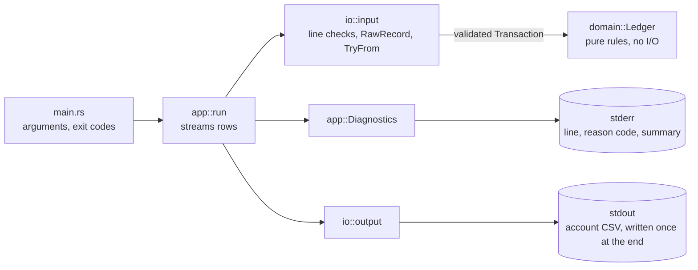
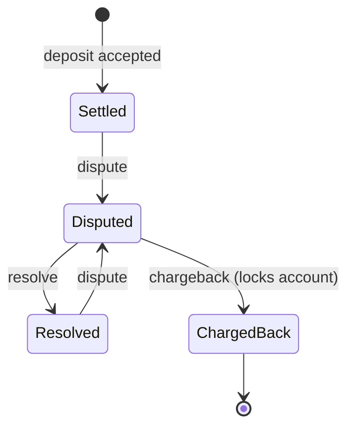
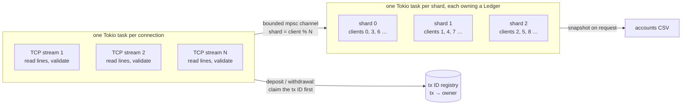

# Toy Payments Engine

A small, streaming payments engine. It reads a CSV of client transactions (deposits,
withdrawals, disputes, resolutions and chargebacks), applies them to one account per
client, and writes every account's final state as CSV.

```console
$ cargo run -- transactions.csv > accounts.csv
```

```text
client,available,held,total,locked
1,1.5000,0.0000,1.5000,false
2,2.0000,0.0000,2.0000,false
```

- stdout carries only the account CSV. Rows that could not be applied are reported on
  stderr with their line number and a reason code, followed by a summary.
- Exit code 0 on success (even if some rows were not applied), 1 if the input cannot be
  read or the output cannot be written, 2 on wrong usage.

[PRODUCT.md](PRODUCT.md) describes the ledger rules and every product decision with its
reasoning. [AGENTS.md](AGENTS.md) holds the engineering principles.

## Key assumptions

Where the requirements leave a gap, the engine behaves like a conservative bank. In
short (full reasoning in PRODUCT.md):

- Only accepted deposits can be disputed. A dispute may push `available` below zero, so
  a deposit that was already withdrawn can still be reversed.
- A dispute, resolve or chargeback must name the client that owns the transaction.
- A resolved deposit can be disputed again; a chargeback is final and locks the account.
- A locked account refuses deposits and withdrawals but still processes disputes on
  earlier deposits.
- Transaction IDs are unique across the input, even when the first use was declined.
- An account is created by a valid deposit or withdrawal, even a declined one; never by
  an invalid row or a dispute event.
- Amounts are positive, have no non-zero digit beyond the fourth decimal place, and
  are never rounded. Output always shows four decimals.
- The input layout is strict: exactly the known columns, lowercase transaction types,
  and no extra fields (which catches `1,000.00` split by the CSV comma). A header that
  breaks the layout stops the run.
- Quotes are ordinary characters, lines are at most 1024 bytes, and line endings are
  LF or CRLF; a longer line or a bare carriage return stops the run.
- An empty or blank-only file is an empty batch.

## Building and testing

Requires Rust 1.85 or newer (edition 2024). Only cargo is needed; the `just` recipes
are shortcuts for the same commands.

```console
$ cargo build --release
$ cargo run --release -- transactions.csv > accounts.csv
```

| just              | What it does                                                                                                                                  | cargo                                                        |
|-------------------|-----------------------------------------------------------------------------------------------------------------------------------------------|--------------------------------------------------------------|
| `just test`       | All tests                                                                                                                                     | `cargo test --locked`                                        |
| `just fmt-check`  | Format check                                                                                                                                  | `cargo fmt --check`                                          |
| `just lint`       | Lints, warnings denied                                                                                                                        | `cargo clippy --all-targets --locked -- -D warnings`         |
| `just doc-check`  | Docs, warnings denied                                                                                                                         | `RUSTDOCFLAGS="-D warnings" cargo doc --no-deps`             |
| `just ci`         | Everything the main CI job runs (MSRV is separate)                                                                                            | the four commands above                                      |
| `just test-props` | Property tests with 10,000 cases each                                                                                                         | `PROPTEST_CASES=10000 cargo test --locked --test properties` |
| `just test-large` | 10 million generated rows through the engine                                                                                                  | `cargo test --locked --release -- --ignored large_input`     |
| `just smoke`      | Copy a fixture to `transactions.csv`, run `cargo run -- transactions.csv > accounts.csv` in `target/smoke/`, diff against the expected output | see the `smoke` recipe in the justfile                       |
| `just msrv`       | Tests on Rust 1.85 (`rustup toolchain install 1.85`)                                                                                          | `cargo +1.85 test --locked`                                  |

## Design



- **`domain`** is pure: money, identifiers, transactions, accounts and the ledger. It
  has no I/O and does not know about CSV, so every rule is unit-tested directly.
- **`io::input`** turns untrusted bytes into a `RawRecord` of text fields, then
  `TryFrom<RawRecord> for Transaction` does every check that needs no state. Checks that
  depend on earlier rows (duplicate IDs, funds, dispute state) belong to the ledger.
- **`app::run`** streams rows through the ledger, reports each row that was not applied,
  and writes the output only after the whole input has been read.

### Using the type system

- `Amount` is a strictly positive fixed-point `i64` (units of 0.0001); `Balance` is the
  signed counterpart. There is no floating point anywhere, and `f32`/`f64` are banned by
  `clippy.toml`.
- `Transaction` is an enum: deposits and withdrawals carry an `Amount`, dispute events
  have no amount field at all.
- `ClientId` and `TxId` are distinct newtypes.
- `Account` balances are private and change only through one method that computes
  available, held and total with checked arithmetic and writes them together, so
  `total == available + held` holds by construction.
- The dispute lifecycle is a small state machine with one transition function:



## Correctness

- **Unit tests** cover every ledger rule and its reason code, the check order, the state
  machine exhaustively, money parsing and formatting at the limits, and every validation
  edge case.
- **51 end-to-end fixtures** in `tests/fixtures/` (input, exact expected output, and
  expected reason codes per line) cover every transaction type, the dispute lifecycle,
  locked accounts, limits, and parsing edge cases such as whitespace, CRLF, a UTF-8 BOM,
  invalid UTF-8, thousands separators, stray quotes and zero-byte input. All sample data was written
  for this repository.
- **Property tests** run generated transaction sequences, shaped so disputes usually hit
  real deposits, and check after every step that totals stay consistent, held funds
  never go negative, locks and chargebacks are permanent, and a rejected row never
  changes any balance. A guard test fails if the generators stop reaching any rejection
  code or dispute transition. Further properties check that arbitrary bytes never cause
  a panic and that chunked reads give identical results. These random-input properties
  are the project's fuzzing: they run on stable Rust in `cargo test`, so there is no
  separate coverage-guided fuzzer (which would need a nightly toolchain).
- **CLI and I/O tests** run the real binary for arguments and exit codes, and inject
  read, write and flush failures into `run`.

## Safety and robustness

- `unsafe` is forbidden, and the `[lints]` table in `Cargo.toml` denies every way
  production code could panic, wrap an integer, truncate with a cast or use a float
  (`clippy.toml` bans `f32` and `f64`), so malformed input cannot cause a panic. See
  that table for the full list; each exception carries a `reason`.
- All money arithmetic is checked; a transaction that would overflow is rejected and
  changes nothing.
- Bad rows are skipped and reported. An unreadable input, a broken header, a line over
  1024 bytes or a bare carriage return stops the run before anything is written to
  stdout. A failed write
  to stdout also exits 1, though part of the output may already be written; the CSV
  writer's flush is checked, so a write failure cannot pass as success.
- CSV quoting is disabled, so one stray `"` cannot merge the following rows into a
  single field and hide them.
- A line longer than 1024 bytes stops the run as soon as its 1025th byte is read, so
  one huge line cannot exhaust memory.
- Input text quoted in diagnostics is truncated and escaped, so it cannot inject
  terminal control sequences. The input path in error messages is escaped the same way.
- Line numbers in diagnostics are physical line numbers. The csv crate's own counter
  skips blank lines and is off by one with CRLF, so the reader tracks lines itself.
  Blank lines are only counted, never stored, so the tracking uses bounded memory.

## Efficiency

- Rows are streamed through a single reused record buffer; the input is never loaded
  whole.
- The state that grows is what the rules need: one account per client (at most 65,536)
  and one record per transaction ID, because any deposit can be disputed later and IDs
  must stay unique. Peak memory for 10 million transactions is about 650–800 MiB,
  almost all of it the transaction map; it varies with when the map last resized.
  `just test-large` runs a similar in-process check with generated input.
- Measured run time for a 275 MB file of 10 million deposits and withdrawals (1,000
  clients), release build, build time excluded:

  | Machine                                           | Run time (wall) | CPU time |
  |---------------------------------------------------|-----------------|----------|
  | Apple M2, 8 cores, 16 GB, macOS 26.3, Rust 1.99.0 | 3.8 s (one run, load not recorded) | 3.3 s |
  | Same machine, load average about 6, five runs     | 7.2–7.4 s       | 5.2–5.5 s |

  The engine is single-threaded, so the time depends mostly on one core's speed and on
  what else is running.
- A production system would bound that map with a dispute window, or move it to disk.

### Many concurrent input streams

This is a design sketch, not implemented. The ledger has no I/O, so it can sit behind any
transport unchanged; the work is in deciding who owns which accounts.



- **Tokio, without a mutex.** Each connection is a cheap `tokio::spawn` task that reads
  lines asynchronously (for example `LinesCodec` with a 1024-byte limit) and validates
  them with the same pure parsing code as the CLI. Each shard is a task that owns its
  `Ledger` and applies commands from a bounded `tokio::sync::mpsc` channel, answering
  through a `oneshot`. One owner per ledger keeps the existing synchronous code and
  needs no lock; a full channel makes senders wait, which is the backpressure.
  `spawn_blocking` per connection is avoided: it would tie up one of a limited pool of
  threads for the whole life of each connection.
- **Shard by client.** A dispute must name the client that owns the deposit, so a
  client's balances and every deposit they can dispute live in the same shard: no
  cross-shard lookups. Rows from one stream for one client go through one FIFO channel,
  so their order is kept.
- **Routing across machines.** `client % N` is enough inside one process. Across
  machines, fixed partitions plus a versioned partition-to-shard directory fit better
  than consistent hashing: there are only 65,536 clients, and moves stay explicit.
- **Global transaction IDs.** IDs must be unique across all clients, but a shard only
  sees its own, so tx 42 could be reused by clients on two shards unnoticed. The proposal
  is a small registry partitioned by tx ID that records `tx → owner`: deposits and
  withdrawals claim their ID there before their shard applies them, and disputes consult
  it only to tell `unknown_tx` from `client_mismatch`. Simpler options (per-shard checks,
  partner-assigned ID ranges) give up either the global guarantee or its verification.
- **Production concerns.** A write-ahead log before acknowledging, periodic snapshots,
  a dispute window to bound memory, and batch control totals per file.

## Project layout

```text
src/
  main.rs             CLI: arguments, files, exit codes
  lib.rs
  app/                run loop and diagnostics
  domain/             money, IDs, transactions, accounts, ledger, rejections
  io/                 CSV input validation and CSV output
tests/
  fixtures/           end-to-end scenarios
  fixtures.rs         runs every fixture
  cli.rs              tests against the real binary
  io_paths.rs         I/O failures, chunked reads, large input
  properties.rs       property tests
  common/             shared helpers and test doubles
```
